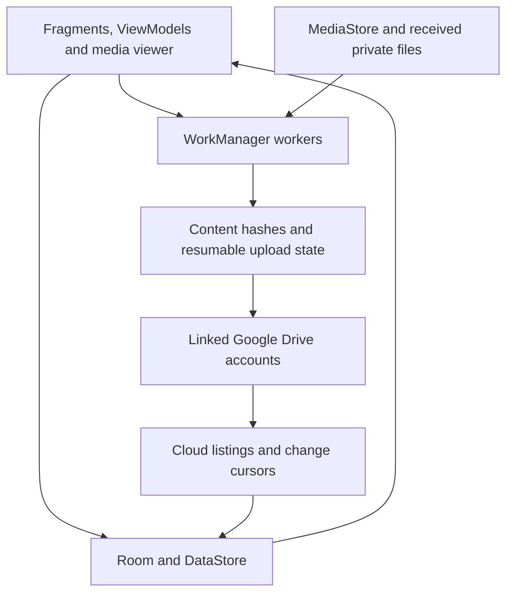

# Photos App

A native Android photo and video library with original-quality backup across multiple linked Google Drive accounts. Browse device and cloud media in one timeline, see what is backed up, organize albums, and recover the cloud library on another phone.

The interface is inspired by Google Photos. This is an independent app; its backup destination is **Google Drive**, and it does not automatically import your existing Google Photos library.

| Project | Current configuration |
| --- | --- |
| App version | Android 2.0.4 (code 15), Web 2.0.0 |
| Android package | `com.photosapp` |
| Minimum Android version | Android 8.0 / API 26 |
| Compile / target SDK | API 35 |
| UI | Kotlin, XML views, Material Components, View Binding |
| Storage | Google Drive originals, Room index, DataStore preferences |

## Website and maintainer guide

**Primary website:** https://photos-app.0143crazy.workers.dev

The Cloudflare Worker serves the React website and a same-origin Google authorization backend. D1 stores browser sessions and encrypted credentials; originals remain in Google Drive. Each browser must connect the accounts containing its backups. The older GitHub Pages site remains a static compatibility build and cannot renew expired Google tokens itself.

Start with these guides before changing code:

- [AI and developer repair guide](docs/MAINTENANCE.md): system map, invariants, diagnosis, regression checks, known gaps and handoff template.
- [Web client](photos-web/README.md): local development, media caching and sync contracts.
- [Cloudflare backend](photos-cloudflare/README.md): secrets, OAuth callback, D1 migrations and deployment.
- [REA review](REA-REVIEW.md): scope and limitations of the reference APK analysis.

Publishing source to GitHub does **not** deploy the Cloudflare Worker. Its deployment is a separate command. The Pages workflow only updates the older static site.

## Contents

- [How multi-account storage works](#how-multi-account-storage-works)
- [Features](#features)
- [Build the app](#build-the-app)
- [Configure Google Drive access](#configure-google-drive-access)
- [Install and start backing up](#install-and-start-backing-up)
- [Recover the library on another phone](#recover-the-library-on-another-phone)
- [Import older Google Photos media](#import-older-google-photos-media)
- [Backup reliability and duplicate detection](#backup-reliability-and-duplicate-detection)
- [Albums, dates and deletion](#albums-dates-and-deletion)
- [Architecture](#architecture)
- [Permissions and privacy](#permissions-and-privacy)
- [Troubleshooting](#troubleshooting)
- [Validation and known limitations](#validation-and-known-limitations)

## How multi-account storage works

The app combines the **view** of several accounts. It does not merge Google's storage quotas or create a shared storage plan.

1. Link the Google accounts you own or are authorized to use.
2. The app reads each account's actual Drive storage quota and usage.
3. Each original file is uploaded entirely to an account with enough available space.
4. App metadata records the file's content hash and capture date.
5. The timeline combines the files discoverable through the linked accounts.

For example, accounts with 5 GB, 10 GB and 2 GB available offer approximately 17 GB of capacity across accounts. A single 6 GB video still needs an individual account with at least 6 GB available. Gmail, Drive and other account usage reduce available capacity. Files are never split across accounts.

## Features

### Library and viewer

- Photos, Collections, Cloud library and On device tabs.
- Date-grouped timeline, filename search, 2/3/4-column grids and a wide draggable date scrollbar.
- Backup badges and filters for backed up, backing up, waiting, not backed up and failed items.
- White photo/video viewer with a centered date/time header and Share, Edit, Add to and Bin actions.
- Video play/pause, elapsed/total time, seeking, mute, frame capture and full-screen viewing.
- Tap the media to hide controls and switch to a black canvas; tap again or press Back once to restore controls.
- Details for available filename, size, capture date, dimensions, video duration, device folder, camera metadata and backup status/account.

### Backup and accounts

- Direct backup of accessible device photos and videos, including existing media.
- Scheduled Camera/DCIM or all-folder backup using WorkManager.
- Mobile-data preference, pause/resume and retry-failed actions.
- Notifications with finished, remaining and failed counts, current file and upload progress.
- Multiple linked accounts, actual per-account storage, account management links and local-only browsing.
- Resumable original-byte uploads with persistent session state and content-hash duplicate checks.

### Organization and import

- Automatic Screenshots, Documents and Videos collections, plus Favorites.
- Create custom albums, choose members and delete album groupings by long press.
- Receive single or multiple actual media files from Android's Share menu.
- Preserve supported capture metadata and edit the timeline date/time manually.
- Rotate/crop photos into an edited copy; open a compatible installed editor for video editing.
- Bin with restore and permanent-delete actions.
- Basic ZIP media import from the account center.

## Build the app

### Requirements

- Android Studio with Android SDK Platform 35 and the build tools selected by Android Gradle Plugin.
- A JDK for launching Gradle; JDK 21 was used for the verified Windows launcher.
- **Java 25 for the Gradle daemon.** The checked-in `gradle/gradle-daemon-jvm.properties` selects Java 25 and provides toolchain download URLs. Install a compatible JDK or allow Gradle's toolchain provisioning on first use.
- Internet access for initial Gradle, toolchain and dependency downloads.
- Google Play services on a phone or Google Play-enabled emulator for account connection.

Source compatibility is Java 21. Gradle is pinned to **9.5.0**, Android Gradle Plugin to **9.3.0**, and KSP to **2.3.5**. The wrapper distribution has a checked-in SHA-256 checksum. Use the wrapper rather than an unrelated system Gradle installation.

### Clone and open

```sh
git clone https://github.com/Crazyvishnu/photos.git
cd photos/photos-android
```

Open `photos-android` in Android Studio and let it sync. Android Studio normally creates `local.properties` with the SDK location; this file is excluded from Git.

For command-line builds, configure `ANDROID_HOME` for your SDK or create `photos-android/local.properties`:

```properties
# Replace with your SDK's absolute path; use forward slashes on Windows.
sdk.dir=C:/path/to/Android/Sdk
```

### Windows / PowerShell

From `photos-android`:

```powershell
$env:JAVA_HOME = 'C:\path\to\jdk-21'
.\gradlew.bat :app:assembleDebug :app:lintDebug --console=plain
```

### macOS / Linux

From `photos-android`:

```sh
./gradlew :app:assembleDebug :app:lintDebug --console=plain
```

The Windows build has been verified. The Unix wrapper is included; a macOS/Linux build has not been verified in this workspace.

| Output | Path relative to `photos-android` |
| --- | --- |
| Debug APK | `app/build/outputs/apk/debug/app-debug.apk` |
| Lint HTML | `app/build/reports/lint-results-debug.html` |
| Lint XML | `app/build/reports/lint-results-debug.xml` |

This source repository excludes generated APKs, local SDK paths and signing keys. For distribution, use Android Studio's **Generate Signed Bundle / APK**, keep the release key private, and register its signing fingerprint for Google account access.

## Configure Google Drive access

The current implementation talks directly to Google Drive through Google Play services and Retrofit. No Firebase project, service-account key, web backend or Android client secret is required for this path.

1. Create or choose a Google Cloud project and enable the **Google Drive API**.
2. Configure the Google Auth Platform consent screen, audience and app information. If the app is in testing, add the Google accounts that will test it.
3. Configure the scope used by this app:

   ```text
   https://www.googleapis.com/auth/drive.file
   ```

4. Create an **Android OAuth client** using package name `com.photosapp` and the SHA-1 of your signing certificate.
5. Register every certificate you actually use, including debug and release certificates, in the same Cloud project. To display build fingerprints, run:

   ```powershell
   .\gradlew.bat :app:signingReport
   ```

   On macOS/Linux, use `./gradlew :app:signingReport`.

6. Install that build, connect an account and grant the requested Drive access. Repeat for each account you want in the combined library.

The `drive.file` scope covers app-created or explicitly authorized files rather than unrestricted access to the entire Drive. See [Google's scope guide](https://developers.google.com/workspace/drive/api/guides/api-specific-auth).

The account connector currently uses deprecated Google Sign-In / GoogleAuthUtil APIs. Before a production release, migrate authentication to Credential Manager and Drive authorization to AuthorizationClient. See [Google's migration guide](https://developer.android.com/identity/sign-in/legacy-gsi-migration) and [Android authorization documentation](https://developer.android.com/identity/authorization).

## Install and start backing up

1. Build the debug APK, then open it on your Android phone and approve installation from your file manager if Android requests it. Alternatively, from the repository root with an authorized USB device connected:

   ```sh
   adb install -r photos-android/app/build/outputs/apk/debug/app-debug.apk
   ```

2. Allow photo/video access. With selected-media access, the app can only back up items you authorize.
3. Connect your Google accounts through the avatar/account center.
4. Choose **Back up device photos & videos** in the account center, or use the backup card to start backup.
5. In **Photos settings**, choose Camera/DCIM or all photo/video folders for scheduled backup, and enable **Use mobile data** if needed.
6. Allow notifications on Android 13+ to see notification-drawer progress.
7. Use status filters to inspect unfinished items. Open a failed item's Details to read the reported error before retrying.

Manual full-device backup scans all accessible photos/videos; scheduled backup follows the selected folder setting. Android battery, background and network policies can delay scheduled work.

**Updating:** use an APK with the same package and signing certificate. A fresh clone normally generates a different debug key, so its APK cannot replace an existing build signed with another key. Keep the original signing key outside Git if update continuity is needed. Uninstalling or clearing app data removes device-only state and imported private copies.

## Recover the library on another phone

1. Install a compatible build using Android OAuth clients from the **same Google Cloud project**.
2. Connect and authorize every account containing your app backups.
3. Open **Cloud library**, or choose **Refresh cloud library** from settings/account center.
4. The app lists each account's app-marked files and reconstructs a merged timeline.

Cloud originals stream when opened; rebuilding the index does not download the entire library. Unlinking an account hides its cloud-only items without deleting them from Drive.

Recovery covers cloud originals and supported app metadata. Android 2.0 syncs custom album definitions and backed-up members through private Drive JSON manifests. Hidden automatic albums, preferences, local Bin bookkeeping, unbacked album members and unfinished upload sessions remain device-local. Reinstalling does not restore that device-only state.

## Import older Google Photos media

Photos stored only in Google Photos are not automatically present on the phone or visible through this app's Drive API connection.

1. Open Google Photos and select photos/videos.
2. Choose **Share**, then **More** if necessary, and select **Photos App**.
3. Share actual files. A web-link-only share cannot be imported.
4. Keep the receiver open while it copies media into private app storage. Google Photos may need to download cloud-only originals first.
5. Review the received/failed counts. With accounts linked and backup permitted, received files are queued for backup; otherwise connect an account and use Back up now.

Embedded photo/video capture metadata and supported provider dates are used when available. Sharing does not guarantee that the original date survives. If no reliable date is available, the received date is used; open the viewer date header or **Edit date & time** to correct it. The timeline then uses the edited date.

The basic ZIP importer extracts recognized image/video entries to MediaStore. It is not a complete Google Takeout migration tool: Takeout JSON sidecars, album reconstruction and every metadata variant are not supported. Imported files consume device storage.

## Backup reliability and duplicate detection

### Completed files

- SHA-256 identifies media content rather than names alone.
- A cached cloud index is refreshed from paginated Drive listings and subsequent change cursors.
- Matching completed app backups are checked before uploading another copy, including after rebuilding the index following reinstall.
- Local fingerprints and saved hashes reduce repeated work. Unknown files may still need a full read to establish their content hash.
- Upload success requires confirmation of the cloud copy, not simply a completed progress animation.

Changing content creates a different hash. Files uploaded by older builds without discoverable app metadata, or inaccessible under another OAuth project/account, cannot always be identified as prior app backups. Separate devices uploading the same new file simultaneously can still create duplicate cloud objects; there is no server-side uniqueness transaction.

### Interrupted uploads

- Originals are read through bounded buffers, without another full-size cache copy of each video.
- A resumable session, owning account and reserved Drive file ID are persisted in Room.
- Drive's acknowledged range determines the next offset after interruptions.
- Chunk sizes adapt to transfer time and network type, with bounded retries/backoff.
- Expired sessions can be recreated using the reserved file ID; retries check for an already completed file.
- Account token caching and small ID batches reduce per-file and per-chunk requests.

These optimizations preserve original uploaded bytes. Backup does not resize photos or transcode videos. Actual throughput depends on upload bandwidth, the device, Google Drive and file size; no fixed speed improvement has been benchmarked.

Notifications count an accessible-device-file snapshot. New media added after that scan and folder restrictions can make remaining counts differ from the gallery. A current backup pass can finish while media outside its selected folder scope remains.

## Albums, dates and deletion

| Action | Behavior |
| --- | --- |
| Automatic albums | Screenshots/Documents use filename and folder/category hints; Videos uses media type. Documents does not perform OCR or include PDFs. |
| Create an album | Create it in Collections, then choose members or use Add to in the viewer. |
| Delete a custom album | Long press the album; deleting its grouping does not delete originals. |
| Hide an automatic album | Long press; restore it later in settings. |
| Edit capture date | Updates the timeline and supported cloud app metadata; does not rewrite the original file's EXIF bytes. |
| Photo edits | Rotation/crop saves an edited JPEG copy with bounded resolution, separately from original-quality backup. |
| Video edits | Exports a copy for a compatible installed external editor. |
| Save as photo | Captures the decoded video frame, capped at 1920 pixels on its longer side. |
| Move to Bin | Hides device originals in this app and moves app cloud backups to Drive Bin; public device originals remain until permanent deletion. |
| Restore | Restores the app item and requests cloud-copy restoration where applicable. |
| Delete permanently | Deletes selected device/private copies and app cloud backups; Android requests device-deletion approval where required. |

Cloud Bin retention is controlled by Google Drive. Device-local Bin state is not a separate durable copy. Android 2.0 and web sync custom albums using versioned manifests and deletion tombstones. Only backed-up members have portable identities. There is no public album-sharing/group-membership service; reconnect the album-owning account to edit it.

## Architecture



| Component under `photos-android/app/src/main/java/com/photosapp` | Responsibility |
| --- | --- |
| `ui/home` | Timeline, collections, account center, settings, viewer, dates and Bin |
| `ui/connect`, `ui/share` | Account connection and Android share receiver |
| `worker/BackupWorker.kt` | Scanning, policy, matching and upload orchestration |
| `worker/BackupNotifications.kt` | Foreground and completion/retry notifications |
| `data/DriveResumableUploader.kt` | Chunk transfer, acknowledgments, recovery and confirmation |
| `data/UploadSource.kt` | Buffered reads and range access |
| `data/CloudLibraryRepository.kt` | Listings, incremental changes and cloud index |
| `data/local/db` | Room entities, DAOs and migrations; current schema version 9 |
| `data/local/PrefsRepository.kt` | DataStore settings |
| `di/ServiceLocator.kt` | Per-account Drive clients, token cache and file-ID pool |
| `worker/MediaActionsWorker.kt`, `DateSyncWorker.kt` | Pending cloud Bin/favorite/date operations |

```text
photos/
|-- README.md
|-- .gitignore
|-- .gitattributes
`-- photos-android/
    |-- app/
    |   |-- build.gradle.kts
    |   `-- src/main/
    |       |-- AndroidManifest.xml
    |       |-- java/com/photosapp/
    |       `-- res/
    |-- gradle/
    |   |-- libs.versions.toml
    |   |-- gradle-daemon-jvm.properties
    |   `-- wrapper/
    |-- gradlew
    |-- gradlew.bat
    |-- build.gradle.kts
    `-- settings.gradle.kts
```

Main libraries include Room 2.6.1, WorkManager 2.9.1, DataStore 1.1.1, Retrofit 2.11.0, OkHttp 4.12.0, Coil 2.7.0 and Media3 ExoPlayer 1.8.0. These are the checked-in versions, not claims that they are the newest releases.

`BuildConfig.BASE_URL` and a LAN cleartext network configuration remain from earlier development. The active Drive client uses `https://www.googleapis.com/` directly; no LAN server is required. Review unused development configuration before production distribution.

## Permissions and privacy

- Photo/video or legacy storage read permissions allow scanning authorized local media.
- Android selected-media access limits what can be browsed and backed up.
- Internet/network permissions support cloud access and backup policy.
- Foreground data-sync and wake-lock permissions support backup within Android's background limits.
- Android 13+ notification permission enables notification-drawer progress.
- Device deletion and legacy write access are requested when required by Android.

Media uploads go to linked Google Drive accounts. Account services manage authentication; passwords and OAuth client secrets are not embedded in source. Original filenames, content hashes and app metadata are sent to Drive with the files. This is not an end-to-end encrypted vault and does not add app-layer encryption to originals.

Room caches account/library metadata and resumable session URLs on the device. Received shares are private local copies until deleted. Android app-data backup is disabled in the manifest. Crash reports remain local until the user chooses to share them. Never publish tokens, session URLs, signing keys, real media or personal diagnostic files in issues.

## Troubleshooting

| Problem | What to check |
| --- | --- |
| Google sign-in fails | Drive API, consent/test users, exact package and installed certificate SHA-1 in the same Cloud project. |
| Empty cloud library on another phone | Connect every owning account, use the same OAuth project and refresh. Google Photos-only files are not app Drive backups. |
| Only a few device items appear | Check Android photo access; selected-media permission exposes only the authorized selection. |
| Videos fail to back up | Read Details, confirm the original is readable/unchanged, check one account has enough free space, then use Retry failed backups. |
| Backup waits on mobile data | Enable Use mobile data, resume backup and check Android data/battery restrictions. |
| Slow progress | Large originals need their full bytes uploaded. Check upload bandwidth and whether the current step is hashing, checking or transferring. |
| No notification | Allow notifications or open Photos settings > Backup notifications and enable the channel. |
| A shared photo appears under today | No usable original date was received. Use Edit date & time. |
| Installation signature conflict | Use the original signing key. New machines normally generate another debug key; do not clear data just to retry an update. |
| Unexpected app closure | Open Photos settings > Last crash report. Native process deaths may not produce a Java/Kotlin report. |
| Gradle cannot find Java/SDK | Check `JAVA_HOME`, SDK location and the Java 25 daemon criterion; allow first-use downloads or install the toolchain. |

## Validation and known limitations

As of 2026-10-29, the latest web suite has **35 passing tests** and the backend suite has **13 passing tests**. The backend-enabled TypeScript/Vite production build and Cloudflare deployment succeeded. Android 2.0.4 passed local debug assembly and lint on 2026-10-29; Android build success is not proof of behavior on a phone.

Google sign-in reached the deployed callback. The browser used for inspection showed zero media under the connected account, so real-library original prefetch, long-term token renewal and video playback remain unverified. Do not report these as proven by mocked tests. Known issues and precise reproduction steps belong in the [repair guide](docs/MAINTENANCE.md).

No connected authorized phone or configured ARTEMIS runtime was available for device validation. Before writing Android UI tests, explore the real screens with ARTEMIS. Verify backup scheduling, repeated share batches, large-video interruption/resume, reinstall deduplication and two-device recovery on hardware.

Other current limits:

- No automatic import of an entire existing Google Photos library.
- No group membership service, face recognition or global duplicate lock. Album conflict resolution uses timestamps, so simultaneous edits can still race.
- No full Takeout sidecar/album migration or OCR document classification.
- Local-only state and unfinished sessions do not survive uninstall/app-data removal.
- Shared private copies need sufficient phone storage; receiving a batch is not a streaming cloud-to-cloud transfer.
- Deprecated account APIs need migration before production distribution.

See the [app module notes](photos-android/README.md) for a concise build reference.

## Shared albums and web sync (2.0)

Room migration 8 -> 9 retains existing records and adds a durable album synchronization journal. Existing local custom albums are queued for export; local-only members stay on the device until backed up. Private Drive JSON manifests use the separate `photosapp.albums.v1` marker, stable Drive member keys and deletion tombstones. The newest timestamp wins; edits are not collaborative transactions. Unlinking an album owner prevents changes to that manifest until reconnection.

Android refreshes cloud media while its home screen is active every minute; the web app refreshes while visible when enabled in settings. Both also support manual refresh. Pending album writes use one unique worker rather than queuing a worker per media file. The phone build preserves its signing certificate for updating existing installations.

Historical web validation: 28 automated checks passed for hashing, ranges, metadata, cursor failure handling, deletion guards, preview caching, visible-thumbnail scheduling, expired-link recovery, stalled-transfer timeouts and all 4,450 timeline items; TypeScript and Vite production build passed. The welcome/settings/album error states and theme persistence were inspected in the browser. A deliberately delayed original verified immediate thumbnail display and left/right photo navigation with controls hidden. These checks use mocked API data; live OAuth, transfer CORS and phone/web round trips still require explicit account authorization and hardware verification.

Android 2.0.1 accepts successive share intents and serializes incoming batches while existing uploads continue. Copied originals and pending backup status remain in the local database; follow-up workers process subsequent batches. On the legacy static website, web authorization survives refresh in the same tab until the Google access token expires. The Cloudflare website instead renews access server-side; cookie expiry, revoked grants or Google policy can still require reconnection.
